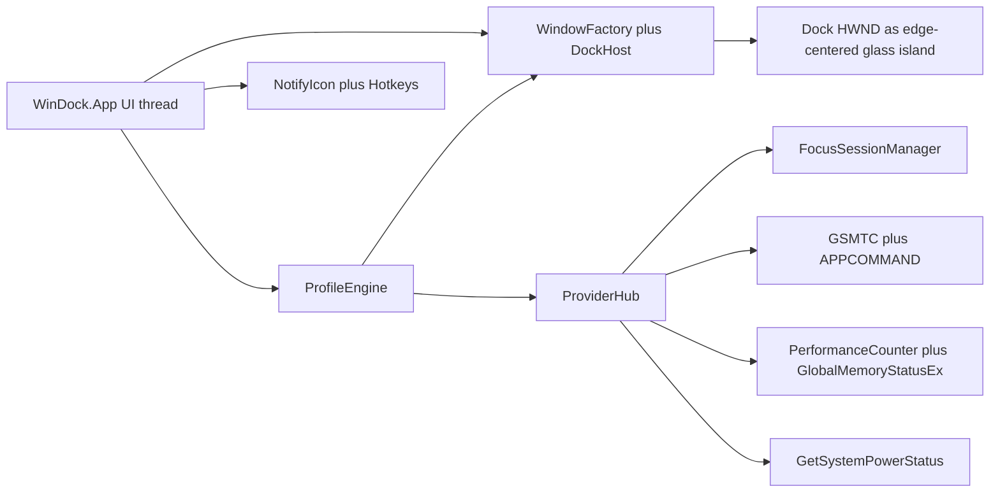
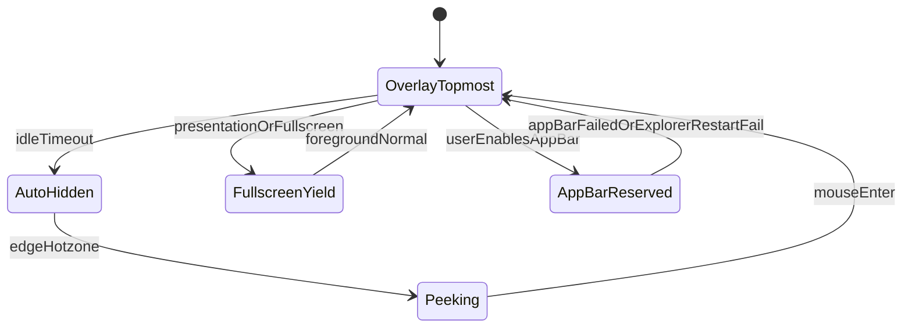

# Sidebox 技术架构

## 选型结论

主干：**C# / .NET 10 WPF 原生宿主 + CsWinRT**。

目标框架：`net10.0-windows10.0.22621.0`。操作系统下限支持 Windows 10 2004+（`SupportedOSPlatformVersion` 10.0.19041.0）。针对 Windows 11 22H2 引入的特性（如 `FocusSessionManager` 与 `DWMWA_SYSTEMBACKDROP_TYPE`）进行运行时探测与优雅降级。WPF 依赖 **Windows Desktop Runtime**，不是只有 `Microsoft.NETCore.App`。本仓库跟本机已装的 .NET 10 Desktop 对齐，避免再下载一份 .NET 8 Desktop。

| 候选 | 结论 |
|---|---|
| WPF + C# | **采用。** HwndSource、托盘、拖放、消息循环成熟，Win32 / WinRT 距离最短。 |
| WinUI 3 | 不做宿主。无边框 Dock、AppBar、命中测试仍要 Win32，省不下集成成本。 |
| Tauri / Electron | 不做常驻宿主。系统窗口工作量不会减少，常驻内存更差。 |
| WebView2 | **MVP 不做。** 阶段 3 再嵌；禁止现在把 widget 画在 WebView 里。 |
| WASDK | MVP 不强制。Focus / GSMTC / 部分网络 API 走 inbox WinRT。Toast 需要时再加。 |
| MSIX / Store | 不是 MVP 门槛。先验证 unpackaged 启动、恢复、卸载。 |

## 进程与窗口

MVP：**单进程**。Dock 与模块共用一个边缘窗口。



- 主 UI 线程：Dock（含模块卡片）、托盘、热键、设置窗。
- `ProviderHub`：系统数据采集与事件聚合；可在线程池采样，**向 UI 派发已成型的快照**。
- 单模块异常：捕获后跳过该卡片，不拖垮 Dock。
- 多进程隔离：阶段 3。不要在 MVP 为每个 widget 起进程。

## 解决方案结构

```
WinDock/
  docs/
  src/WinDock.sln
  src/WinDock.App                 入口、托盘、设置、启动参数
  src/WinDock.Core                领域模型、ProfileEngine、权限门闩
  src/WinDock.Shell               AppBar、DPI、显示器、Z 序、自动隐藏
  src/WinDock.Providers           Focus / Media / Perf / Network / Power / Time / Bing
  src/WinDock.Widgets             内置 WPF widget 视图
  src/WinDock.Infrastructure         JSON、便笺 txt、日志、原子写
  tests/WinDock.Core.Tests
```

项目依赖（单向，禁止环）：

```
App → Widgets, Shell, Providers, Infrastructure, Core
Widgets → Core
Shell → Core
Providers → Core
Infrastructure → Core
Core.Tests → Core
```

`WinDock.App` 与 `WinDock.Widgets` **禁止** `DllImport`。P/Invoke 只允许出现在 `WinDock.Shell` 与 `WinDock.Providers`。例外：`NativeTrayIcon` 的托盘窗口和 `Shell_NotifyIcon` 留在 `WinDock.App`，因为托盘菜单走 WinForms，不进 Shell 的 Dock 窗口。

## 模块职责

| 契约 | 项目 | 职责 |
|---|---|---|
| `IWindowFactory` | Shell | **已废弃。** 独立 widget 窗不交付；模块只嵌在岛上 |
| `IDockLayoutService` | Shell | 边缘几何、工作区、任务栏避让 |
| `IAppBarService` | Shell | 契约已定义；当前实现恒失败并保持 Overlay。设置不开放 AppBar |
| `IDisplayService` | Shell | 拓扑快照、防抖、迁移 |
| `IZorderPolicy` | Shell | Topmost / Yield / AutoHide；**禁止 WorkerW** |
| `IProviderHub` | Providers | 系统数据唯一出口；widget 禁止直接调 Win32 / WinRT |
| `IFocusProvider` | Providers | `IsSupported` 门闩 + `IsFocusActiveChanged` |
| `IMediaProvider` | Providers | 会话变化、钉选、控制失败降级 |
| `IBingWallpaperProvider` | Providers | Bing 图库、本地缓存、`SPI_SETDESKWALLPAPER` |
| `IPerfSampler` | Providers | `PerformanceCounter` + `GlobalMemoryStatusEx`；按模块 Start/Stop |
| `IPermissionGate` | Core | widget / provider 订阅前检查隐私开关 |
| `IProfileEngine` | Core | 纯逻辑：`ContextSnapshot` → `ProfileDiff` |
| `ISettingsStore` | Infrastructure | 原子写、bak 回滚、schema 迁移 |

## Dock 窗口状态



实现要点：

- 默认 Overlay Topmost，不调用 AppBar。HWND 是贴边缘居中的悬浮岛，尺寸跟模块内容走；满宽只留给以后的 AppBar。
- 自动隐藏时窗口收成贴边细条（约 4px），热区对齐岛宽（含从工作区边到岛的走廊），不是 `Hide()` 整窗消失。
- 岛面半透明：分层 HWND，关掉 `DWMWA_SYSTEMBACKDROP_TYPE` 和窗口级亚克力（后者会铺满整扇窗口，把透明度滑块盖掉）。通透由岛面 WPF 底色的 alpha 决定；云母 / 磨砂 / 玻璃用不同色和通透倍率。模块仍是压在岛面上的药丸卡片。失败回退半透明实色。
- AppBar 尚未产品化：`StubAppBarService` 恒失败，运行时保持 Overlay。
- 全屏：`SHQueryUserNotificationState`（D3D / 演示）成功且不是这两种状态时**不再**用 97% 矩形启发式。启发式仅当 QUNS 失败，并排除 `WS_MAXIMIZE`。Z 序靠 `SetWinEventHook`（前台/移动结束等）触发，常态约 2s 兜底；自动隐藏/Peek 时热区约 100ms。**禁止** `WH_KEYBOARD_LL`。
- 图标：`SHGetImageList` 优先按导出名调用，失败再 ordinal `#727`，这是图标回退而不是实验桌面层。
- `WS_EX_TRANSPARENT` 只用于明确的背景层；用户按 Alt 或进入普通前台时恢复命中。

## 显示器与 DPI

事件组合：

1. 原生窗口处理 `WM_DISPLAYCHANGE`
2. `SystemEvents.DisplaySettingsChanged`
3. 防抖 400–800ms
4. `QueryDisplayConfig` + `EnumDisplayMonitors` / `GetMonitorInfo` 做最终一致

显示器身份：优先 `QueryDisplayConfig` 的 device path；失败回退 GDI `DeviceName`。规则匹配失败则迁主屏。

DPI：`app.manifest` 声明 Per-Monitor v2；按窗口缓存 `GetDpiForWindow`，禁止单一全局缩放。跨屏拖动时按目标屏重新布局。

启动参数 `--safe`：强制 Overlay、禁用 AppBar、不把模块卡片放上 Dock，并停止 CPU / 网络 / 媒体 / 电源采样。设置、拖放与图标均不可用，托盘标明安全模式。

## 系统数据

| Provider | API | 约束 |
|---|---|---|
| Focus | `Windows.UI.Shell.FocusSessionManager` | 仅在 Win11 22H2+（Build 22621+）启用；Win10 / 不支持环境下自动回退为禁用触发器与相关状态 |
| Media | `GlobalSystemMediaTransportControlsSessionManager` | 事件订阅；已有正在播放的 GSMTC 会话时不再扫描本地播放器进程；控制失败静默；元数据受 `media.read` 门闩。模块当前未上架（`NowPlayingEnabled = false`） |
| CPU / Memory | `PerformanceCounter("% Processor Time")` + `GlobalMemoryStatusEx` 物理内存 | 仅当 Dock 上有系统状态模块时 `Start`；2s；失败显示「—」 |
| Network | `NetworkInterface` 速率差值 + `NetworkChange` | 仅当有网络模块时采样；`networkDetails=false` 时只查联通、不枚举适配器；过滤 loopback / vEthernet / Hyper-V / Bluetooth |
| Power | `GetSystemPowerStatus` + Hands-Free / 已配对蓝牙电量属性 | 仅当有电源模块时 `Start`；无电池时岛上显示「无电池」，悬停说明「未检测到本机电池」 |
| Time | 本地时钟 | 不访问网络 |
| Notes | `%AppData%\Sidebox\notes\{id}.txt` | 仅本地；编辑自动保存 |

Focus 禁止：轮询 WNF、读 Focus Assist 注册表、推断“正在开会 / 游戏”。

媒体：首次显示前提示；按 profile 可关。优先 GSMTC 会话与系统传输控件；失败或不存在时再回退本地窗口命令。不保证所有播放器都有封面或控制。

日历（stretch）：`AppointmentStore` 在 unpackaged 下常不可用。本地库优先；系统日历必须检测能力并降级。

## 热键、托盘、自启

- 热键：`RegisterHotKey` 挂在消息窗口上（下一个 / 撤销）。**禁止** `WH_KEYBOARD_LL`。
- 托盘：监听 `TaskbarCreated` 后重建图标；单击打开设置；文案不超过 63 字符，开启情景时带当前情景名。
- 单实例：`Local\Sidebox.SingleInstance`。
- AppBar 模式尚未开放。
- 自启：设置「开机启动」写 `HKCU\Software\Microsoft\Windows\CurrentVersion\Run`（用户级，`asInvoker`）。
- 运行身份：`asInvoker`。需要提权的功能不得抬升整个进程。

## 持久化与路径

- 配置：`%AppData%\Sidebox\settings.json`
- 备份：同目录 `settings.bak`
- 便笺：`%AppData%\Sidebox\notes\{id}.txt`（旧版单文件 `notes.txt` 迁入第一份）
- 日志：`%LocalAppData%\Sidebox\logs\`
- 图标缓存：`%LocalAppData%\Sidebox\icon-cache\`
- 媒体封面：`%LocalAppData%\Sidebox\media-thumbs\`

写入协议：写 temp → flush → replace；成功后复制一份 bak。读取失败则尝试 bak，再失败则把损坏文件改名为 `settings.corrupt.<timestamp>` 并写入出厂默认。更高 `schemaVersion` **不覆盖**用户文件，内存使用出厂默认并提示。未知 widget / 非法 dock 项会被丢掉而不是抛错。`id` 缺省时生成 GUID 并写回磁盘。

密钥：MVP 无支付、无 DPAPI 字段。便笺为明文 txt。

## 工程规则

1. 禁止 WorkerW、Progman、`SHELLDLL_DefView`、向 Explorer 发私有消息。作为 PR 检查项。
2. 禁止为 Focus 读取未文档化状态。
3. 任何管理员能力必须单独动作 / 单独进程，不能抬升 Dock。
4. Provider 只暴露 pull / event；widget 不轮询 Win32。
5. 外部动作写审计日志。脚本插件不在 MVP。
6. 升级用 `schemaVersion`；失败回滚 `settings.bak`。
7. 空闲（仅 Dock + 时钟）工作集目标 &lt; 80MB；系统状态模块未上岛时不采样 CPU；环形缓冲，禁止内存单调涨。

## 测试分层

- **Core 单测**：触发器优先级、手动覆盖、权限门闩、schema 默认值。不依赖 Win32。
- **Shell 手工矩阵**（M1 起）：DPI 125/150/200、插拔显示器、锁屏、Explorer 重启、全屏游戏、自动隐藏热区。`HostPerfTests` 只覆盖几何/热键/钉选辅助，不是工作集测试。
- **Provider 兼容**：Focus 有/无；Edge 网页媒体；至少一种桌面播放器；无电池台式机。
