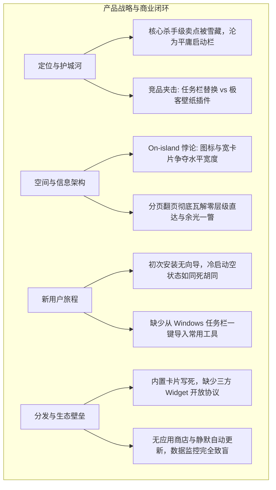
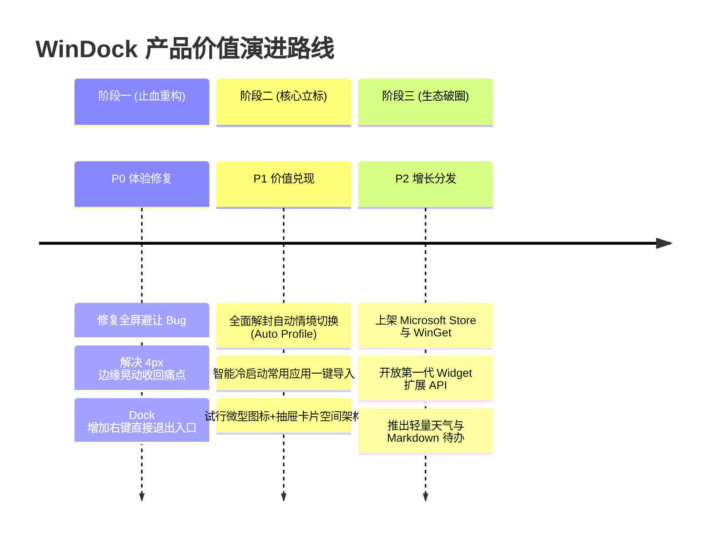

# WinDock 专精审查分册：产品经理视角（定位、信息架构与增长闭环）

> **文档定位**：面向产品总监、商业化负责人与系统设计者的产品战略与增长审查报告。  
> **核心维度**：竞争格局与定位护城河、信息架构空间悖论（On-island 困境）、新用户激活漏斗（Cold-start）、生态扩展与现代分发管道。

---



---

## 一、 竞争格局与护城河：杀手级卖点的雪藏代价 (Market Positioning & Moat)

### 1. 桌面效率工具竞争全景矩阵

| 竞品类别 | 代表产品 | 核心优势 | 用户心智 | WinDock 当前的竞争窘境 |
| :--- | :--- | :--- | :--- | :--- |
| **原生增强 / 任务栏接管** | **StartAllBack** / **RetroBar** | 深度 Hook Explorer，完美接管任务栏与系统托盘，毫秒级响应 | “取代或改良不好用的 Windows 任务栏” | WinDock **放弃接管任务栏**，用户日常仍需使用任务栏，两者功能高度重叠。 |
| **桌面美化与重型挂件** | **Rainmeter** / **SAO Utils** | 拥有无限自由度的画布级排版，数十万社区开源皮肤生态 | “把整个桌面打造成属于自己的炫酷终端” | WinDock 仅有几个写死的内置小组件，排版极度受限，无法满足个性化定制。 |
| **macOS 深度仿冒工具** | **MyDockFinder** | 极致还原 macOS 图标放大动效、神灯最小化特效、圆角拟物 | “在 Windows 上获得逼近 Mac 的视觉享受” | WinDock 坚持 Windows 11 Fluent 扁平极简，动效克制，无法吸引视觉拟物控。 |
| **键盘效率启动器** | **PowerToys Run** / **Listary** | `Alt+Space` 键盘毫秒级直达，全局文件检索与计算器 | “双手不离键盘，极速启动与搜索” | 键盘启动比用鼠标去屏幕边缘撞击更快捷，挤压了 WinDock 作为启动器的价值。 |

---

### 2. 唯一护城河：情境自动感知（Contextual Desktop Switching）
* **产品原点战略**：
  * [docs/PRODUCT.md](file:///H:/projects/WinDock/docs/PRODUCT.md#L3-L13) 曾精准抓住了现代知识工作者的核心痛点：**不同工作场景下的认知过载**。
  * 用户在“办公室双屏写代码”和“会议室投影做演示”时，需要的应用、小组件、隐私级别是截然不同的。
* **致命的商业断层**：
  * 在代码层 [`ProductFeatures.cs#L16`](file:///H:/projects/WinDock/src/WinDock.Core/ProductFeatures.cs#L16) 中，`AutoProfileTriggersEnabled` 被硬编码封死；
  * **商业代价**：关掉自动情境切换后，WinDock 的产品形态直接退化为“又一个顶部图标栏”。在上述 4 大强敌环伺的红海中，WinDock 失去了唯一能打动用户的决定性理由。

#### 💡 核心场景重构方案：
```
【场景 A：工位双屏（外接显示器连接）】
  -> 自动激活「生产力情景」：钉选 VS Code、Terminal、飞书、Git 提交状态、网络流量折线、双时区。

【场景 B：开会演说（拔掉扩展坞 / 投影模式）】
  -> 自动激活「会议投屏情景」：瞬间隐去敏感私密便笺与社交工具，仅保留 PPT、浏览器、会议静音与极简时钟。

【场景 C：深度工作（Windows 开启 Focus / 下班时间）】
  -> 自动激活「极简专注情景」：精简所有干扰卡片，仅保留本地番茄钟（FocusTimer）与网易云音乐播放控制。
```

---

## 二、 空间架构矛盾：“药丸嵌在条上”的物理承载力死局 (Information Architecture)

### 1. 启动图标与横向小组件争夺屏幕宽度的数学死局
* **现实度量分析**：
  * 知识工作者的常用 App 一般在 **8 ~ 12 个**，以 48px 图标 + 内外边距计算，基础启动器宽度至少需要：
    $$10 \times (48 + 12) = 600\text{px}$$
  * 如果用户希望同时在 Dock 上常驻查看信息：
    * 网络卡片（含上下行与折线）：约 **160px**；
    * 系统状态（CPU/内存）：约 **120px**；
    * 正在播放音乐控制：约 **180px**；
    * 时钟与便笺：约 **140px**。
  * 累加总宽度已突破 **1,200px**。在笔记本屏幕（如 13~14 英寸 1080P 或 2K 缩放）下，这个宽度几乎横跨了整个屏幕顶边。

---

### 2. 分页指示器（左右翻页箭头）对核心价值的彻底瓦解
* **体验悖论**：
  * 当前设计在内容溢出时，在 Dock 两端渲染翻页箭头；
  * 但我们必须追问桌面工具的底层价值法则：
    1. **启动器（Launcher）的铁律是“零层级直达”**：如果一个常用应用被翻页到了第 2 页，用户要先点翻页再点图标，耗时远超 `Win + 键入应用名 + 回车`；
    2. **桌面挂件（Widget）的铁律是“余光一瞥（Glanceable）”**：用户看网络速率或 CPU 占用，需要的是“眼睛一抬即知”。如果信息被埋在第 2 页，用户绝对不会主动点翻页去查看。
  * **结论**：**分页机制实质上在逻辑上宣告了“药丸嵌在条上（On-island）”信息架构的破产**。

---

### 3. 破局之道：两种更具前瞻性的空间拓扑草图

#### 方案 A：分离式双岛拓扑（Split Island Architecture）
将不可调和的两类诉求在物理空间上彻底解耦：

```
+-----------------------------------------------------------------------------------+
|  [ ☀ 24°C | ⇡1.2M ⇣3.8M ]             [  🌐 📁 📝 ⚙ ]             [ 14:32:05 ⚡ 98% ]  |
|      (左侧：状态胶囊)                   (中央：纯应用启动岛)             (右侧：时间控制胶囊)    |
+-----------------------------------------------------------------------------------+
```
* **优势**：中央启动岛保持极高密度、对称居中；两侧状态胶囊自适应贴近顶角，完美契合人眼余光扫视路径。

#### 方案 B：双态抽屉架构（Two-Tier Micro-Island）
主条只保留纯微型图标（24×24），严禁水平横向展开：

```
主条常驻态: [  🌐  📁  📝  |  📶  ⚡  ⏱️  ]  (整条宽度紧凑控制在 400px 以内)
                                 |
                                 v (Hover / 点击轻量下弹抽屉)
                        +----------------------+
                        | 📶 网络详情          |
                        | 上行: 1.2 MB/s (折线) |
                        | 下行: 4.8 MB/s       |
                        +----------------------+
```
* **优势**：极度节省横向空间，常驻态绝对不超标，详情随时按需展开。

---

## 三、 用户旅程断崖：初次激活与空状态体验 (Activation & Retention)

### 1. 冷启动死胡同（Empty State & Zero Tour）
* **现状流失分析**：
  ```
  新用户下载安装 
      │
      ▼
  首次启动：屏幕顶端突兀出现一条仅有时钟+便笺的黑条 (无任何气泡说明)
      │
      ▼ (心智困惑：这东西用来干嘛的？)
  误操作右键移除时钟和便笺
      │
      ▼
  Dock 缩成一条细线显示 "(空)"
      │
      ▼ (体验冰点：无法恢复、没有一键预填)
  3 分钟内打开控制面板卸载 (Churn)
  ```

---

### 2. 破局：首屏 30 秒智能激活方案（Smart Cold-Start）
1. **Windows 任务栏常用程序一键提取**：
   * 首次启动时，代码自动扫描系统任务栏配置路径：  
     `%APPDATA%\Microsoft\Internet Explorer\Quick Launch\User Pinned\TaskBar`
   * 自动探测用户已经在任务栏常驻的 5 个最高频应用（如 Chrome、资源管理器、VS Code、微信）；
   * 弹出一张高颜值的半透明浮层卡片：  
     *“检测到您常用的 5 款应用，是否一键导入生成您的首个 Dock？”*
   * 一键即可让 Dock 瞬间充实、美观，大幅跨过冷启动门槛。
2. **轻量交互导览（3 步极简 Tour）**：
   * 浮动小气泡分别指示：“直接从桌面拖拽图标入 Dock”、“右键卡片自由切换紧凑模式”、“按 Win+Shift+D 体验情景切换”。

---

## 四、 分发管道、生态扩展与数据闭环 (Distribution & Ecosystem)

### 1. 告别纯手动发布：接入现代 Windows 分发管道
* **现状**：目前仅依赖 GitHub Release 打包 `Inno Setup` 安装包，更新完全依赖用户手动去 GitHub 重新下载覆盖；
* **分发升级建议**：
  1. **接入微软商店（Microsoft Store）**：使用 MSIX / Desktop Bridge 打包上架，享受 Windows 11 原生商店的巨大流量曝光与零门槛一键安装信任；
  2. **收录至 WinGet 官方源**：支持企业与极客用户通过 `winget install WinDock` 命令行一键部署；
  3. **集成 Velopack / Squirrel 静默自动更新**：在后台无感下载差分升级包并在闲时重启更新，避免用户停留在包含致命 Bug 的老旧版本中。

---

### 2. 插件生态：开放极简 Widget SDK
* **痛点**：当前所有 12 个模块均为编译期写死在源码中，无法调动外部开发者；
* **生态建议**：
  * 定义基于 JSON Schema + WebView2 / 轻量 WASM 的小组件标准接口；
  * 允许社区第三方自由开发诸如：*网易云/QQ音乐桌面歌词*、*GitHub 动态贡献墙*、*股票与加密货币行情*、*Pomodoro 看板*；
  * 从一个单机小工具进化为一个充满生机的**微桌面生态平台**。

---

## 五、 产品经理视角演进里程碑 (PM Strategic Roadmap)


