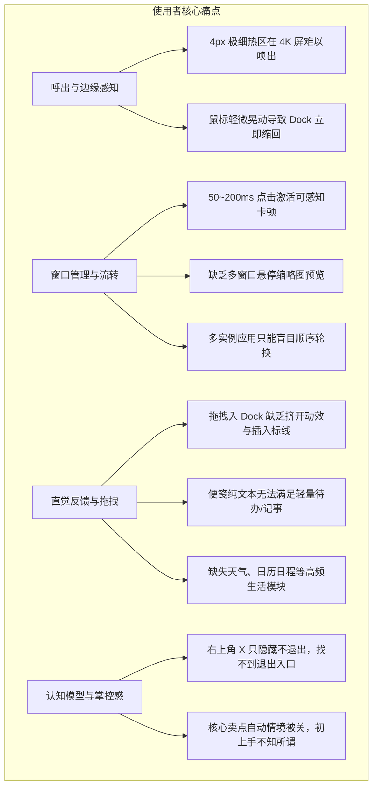

# WinDock 专精审查分册：使用者视角（体验、人机工程与日常交互）

> **文档定位**：面向桌面效率追求者、多屏工作者与交互设计（UX）团队的真实使用体验审查报告。  
> **核心维度**：操作响应迟滞、人机工学与 Fitts 定律痛点、日常多窗口流转断层、模块实用性与心智模型对齐。

---



---

## 一、 边缘自动隐藏与人机工学痛点 (Ergonomics & Edge Interaction)

### 1. 2K/4K 高分屏下的“4px 细丝陷阱”
* **现象描述**：
  * 当用户开启默认的 `AutoHide`（自动隐藏）后，Dock 收缩在屏幕顶部，仅留下一条约 4px 的极细条纹；
  * 在当前主流的 27 英寸 4K 显示器（150% 缩放）或轻薄本 2.8K 屏幕上，4px 的物理视觉宽度甚至不足 1 毫米，用户肉眼极难定位；
  * 虽然系统在顶部提供了约 8px 的热区判定，但由于用户使用的鼠标回报率、指针加速度设置各异，用户经常必须小心翼翼地把鼠标“蹭”到屏幕边缘才能勉强唤出。

---

### 2. 鼠标离开即缩回的“追逐挫败感”（缺少磁滞容错期）
* **人机工学缺陷推演**：
  1. 用户将指针撞击屏幕顶部，Dock 顺滑滑出展开；
  2. 用户的视线和手腕开始向下滑动，准备点击 Dock 上的第 3 个图标；
  3. 如果用户的手腕在向下滑动过程中产生微小偏角，指针稍稍越过了 Dock 的下边缘（哪怕仅 3~5 像素）；
  4. 由于当前代码在 [`DockSession.cs#L1200`](file:///H:/projects/WinDock/src/WinDock.App/DockSession.cs#L1200) 的 100ms 循环中单帧判定 `IsPointerOverIsland()` 为 `false`，Dock **瞬间执行缩回动画**；
  5. 用户正准备按下的鼠标左键直接点到了下方的浏览器网页或桌面，引发误触（Mis-click），造成极度强烈的“捉迷藏”式抓狂体验。

```
【当前设计：零容错边界】
  屏幕顶边 ============================================
               [  WinDock 主面板 (展开态)  ]
  判定下沿 -------------------------------------------- <-- 离开 1px 立即缩回！
               (用户准备点击的光标路径 ✘ 极易脱靶误触)

-------------------------------------------------------

【优化设计：动态感应梯形与磁滞延时区】
  屏幕顶边 ============================================
               [  WinDock 主面板 (展开态)  ]
  保护下沿 - - - - - - - - - - - - - - - - - - - - - -
             \     300ms 磁滞延时保护扇区 (Trapezoid)    /
              \_______________________________________/
               (用户即使滑出，300ms 内滑回依然保持展开 ✔)
```

* **体验改进建议**：
  * **引入 300ms 磁滞退避延时（Hysteresis Delay）**：当指针离开 Dock 视觉边界时，不立即触发收回，而是启动一个 300ms 的保护倒计时；若在此窗口期内指针重新进入，则平滑维持展开状态；
  * **构建防脱靶梯形感应区（Trapezoid Trigger Cone）**：在 Dock 底部向下延伸出 15~20px 的隐形交互缓冲区，允许用户在快速手势滑动时拥有更高的手抖容错度。

---

## 二、 运行中应用的流转与操作迟滞 (Window Flow & Latency)

### 1. 点击激活已有应用的“钝感”（Click-to-Activate Latency）
* **真实场景反馈**：
  * 用户看到 Dock 上的 Chrome 图标下方亮起已运行小圆点，点击该图标期望切回浏览器；
  * 在点击后，通常有 **50ms 至 200ms 的明显停顿**，鼠标按下的视觉反馈延迟，让用户怀疑自己“没点中”而下意识进行二次点击；
* **深层根源**：
  * 如技术分册所述，点击动作直接在 UI 线程同步枚举了全系统数百个进程的句柄并进行窗口匹配；
  * 对比 Windows 原生任务栏（点击响应通常在 5ms 以内，近乎零感知），WinDock 存在明显的迟钝感。

---

### 2. 多窗口实例下的“盲人摸象”与循环地狱
* **对比主流桌面 Dock / 任务栏交互**：
  * **macOS Dock / Windows 任务栏**：鼠标悬停在多窗口应用（如打开了 4 个 Word 文档、3 个 VS Code 窗口）上时，会优雅弹出**所有窗口的实时缩略图预览（Hover Thumbnail Peek）**，用户可以一眼识别出哪一个是正在写的报告，单击直接精准置顶，或者直接在预览图右上角点击红叉快速关闭冗余窗口。
  * **WinDock 现状**：
    1. **悬停无任何预览**：用户完全不知道当前应用后台到底挂了几个窗口、各自是什么标题；
    2. **强制顺序轮换（Sequential Cycling）**：用户必须通过不断点击图标来依次切换下一个窗口。如果你打开了 5 个窗口，想找第 4 个，必须按节奏狂点 4 次；若不小心多点了一下，又得重新点一整圈；
    3. **无法快捷关闭**：如果某个后台窗口卡死或不再需要，在 WinDock 的右键菜单里找不到任何“关闭该窗口”的选项，用户依然不得不求助于系统的 Alt+Tab 或原版任务栏。

---

## 三、 图标组织与日常拖拽反馈 (Icon Organization & Feedback)

### 1. 拖拽重排的“盲盒落点”
* **现象描述**：
  * 当用户从桌面拖入一个快捷方式，或者在 Dock 内部按住图标试图调整顺序时；
  * 当前界面缺乏明显的**插入指示标线（Drop Insertion Caret）**，也没有相邻图标被自然挤开的平滑位移动画（Push-aside Physics Animation）；
  * 用户只能凭感觉在两个图标之间的微小空隙松开鼠标，常常导致图标没有落入预期位置，甚至触发了“重叠替换”的错觉。

---

### 2. 便笺模块过于极简，无法承载轻量日常备忘
* **现状痛点**：
  * 便笺（Notes）卡片在 Dock 展开后，仅提供一个无格式的纯文本输入框；
  * **不支持最基础的 Markdown / 待办复选框（Checkboxes）**：现代知识工作者使用便笺 80% 的诉求是“随手记下今日待办（To-Do）并打勾”，纯文本无法满足该核心诉求；
  * **不支持文本溢出滚动与自动换行优化**：稍微记录一段长链接或几行备忘录，内容就容易被视口裁剪，体验远逊于 Windows 原生 Sticky Notes。

---

### 3. 日常生活与办公刚需挂件的缺失
* **用户画像调研**：
  * 现代桌面挂件用户最希望在屏幕边缘一眼获取的高频信息排序为：
    1. **当前天气与温湿度**（出门/穿衣一眼决策）；
    2. **今日日程安排 / 倒数日**（下一场会议在几点）；
    3. **待办清单（Todo）**。
  * WinDock 目前内置的 12 个模块中，过于偏向系统底层监控（CPU/内存、网络上下行微积分、电源外设、秒表倒计时），而**日常办公人群最刚需的天气与日程在 MVP 中被全部搁置**，导致产品极客味过重，难以打动泛白领办公人群。

---

## 四、 心理模型冲突与退出掌控感 (Mental Model & Coexistence)

### 1. 难以捉摸的退出路径（“我怎么关掉它？”）
* **用户行为迷宫**：
  1. 新用户尝试体验 WinDock，体验完毕后打开了设置窗口，点击右上角的 `X`；
  2. 结果设置窗口关闭了，但屏幕上方的 Dock 纹丝不动；
  3. 用户在 Dock 面板的空白处疯狂右键，弹出的菜单只有“设置”、“锁定 Dock”、“关于”，**完全没有「退出程序」的选项**；
  4. 绝大多数非极客用户习惯了“主界面右键退出”，不知道必须去屏幕右下角的系统托盘（甚至隐藏的小箭头托盘区）里寻找软件图标才能退出。这给新用户留下了“流氓软件、难以关掉”的极其恶劣的第一印象。

---

### 2. 与 Windows 原生任务栏的心智竞争
* **定位认知的撕裂**：
  * WinDock 默认建议放在“屏幕顶部边缘”；
  * 但绝大多数用户在打开浏览器、办公软件最大化时，视线最上方是浏览器的数十个标签页。如果开启了 Topmost 置顶，Dock 会直接遮挡浏览器最核心的“新建标签”和“切换标签”区域；如果开启自动隐藏，鼠标去点浏览器标签时又极容易误触滑出 Dock 遮挡视线；
  * 用户会陷入两难境地：“放顶部挡标签，放底部挡任务栏，放左右侧又浪费大量纵向空间”，若不提供如同原生任务栏那样真正的**工作区物理避让（AppBar Reserve）**，用户最终往往因屏幕空间冲突而选择卸载。

---

## 五、 使用者体验改进优先级与期望度 (UX Priority Matrix)

| 体验维度 | 改进建议 | 解决的核心抱怨 | 期望度 (Kano) |
| :--- | :--- | :--- | :--- |
| **边缘呼出** | 增加 300ms 磁滞延时与防手抖梯形区 | “鼠标刚滑出来手一抖 Dock 就缩回去了” | **基本型需求** (必须有) |
| **应用流转** | 引入轻量 DWM 窗口缩略图悬停预览 | “开了几个 Word 文档，点图标只能像抽奖一样挨个切” | **期望型需求** (大幅提振体验) |
| **应用退出** | 在 Dock 空白处右键菜单直接提供「退出 WinDock」 | “为什么关了设置这东西还在，我想退出关不掉” | **基本型需求** (必须有) |
| **办公模块** | 引入轻量本地天气小组件与 Markdown 便笺待办 | “纯文本便笺没法打勾，想看一眼今天多少度都没有” | **兴奋型需求** (打动用户) |
| **拖拽交互** | 拖入图标时增加光标插入标线与挤开弹性微动效 | “把图标拖进 Dock 像开盲盒，不知道松手会掉在哪” | **期望型需求** (提升品质感) |
